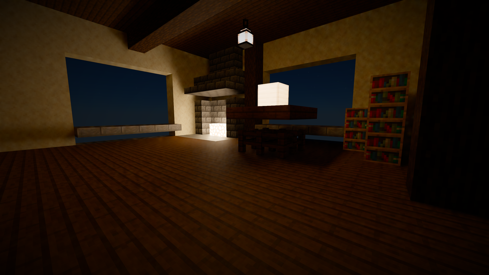

# Sulkan cinematic development

An experimental development fork targeting Minecraft 26.3 and Sodium 0.9.2.
The own pack implements HDR sunlight, hardware Vulkan ray-query shadows,
alpha-tested terrain traversal, diffuse paths, smooth and rough reflections,
water and volumetric clouds. Lower-resolution world HDR passes through native
DLSS Quality before 2560x1440 display. These are opt-in prototypes, not an
accepted cinematic release. Moving gameplay, first-person rendering and the
finished material/light response remain incomplete.

## Current checkpoint — 2026-10-18

- Camera-relative rays and bounded geometry pages; scoped 16-to-32-chunk and
  same-pack reload checks. Long-travel coverage remains open.
- Opt-in night atmosphere, lunar surface light, procedural Moon/stars and
  exposure. Lunar power and visible-disk compression are artistic choices.
- A real textured interior with warm emitters and optional area-light MIS.
- Optional rough reflection reconstruction. In a 24-frame stationary floor
  crop, native-display temporal standard deviation decreased by about 82%;
  this does not establish stable reflected motion or eliminate noise everywhere.
- Outdoor diffuse/cloud cost, dark ground/flat foliage, moving reflection
  history, first-person behavior and retained water/source precision failures
  are still open. The user instance is not updated by this repository upload.

See [ROUGH_DENOISING.md](ROUGH_DENOISING.md), [EMISSIVE_LIGHTS.md](EMISSIVE_LIGHTS.md),
[NIGHT_SKY.md](NIGHT_SKY.md), and [IMAGE_QUALITY_PLAN.md](IMAGE_QUALITY_PLAN.md).
[PUBLICATION_STATE.md](PUBLICATION_STATE.md) describes the source snapshot,
build prerequisites and intentionally local evidence. No NVIDIA SDK/runtime
binaries, game saves, accounts or launcher files are included.

[Actual 24-frame floor comparison](docs/previews/rough-noise-before-after.gif)

## Implementation notes

Optional leaf transmission adds colored solar visibility and front/back leaf
lighting. Independent CPU/GPU checks, current artifact hashes and the corrected
natural-camera evidence are in [FOLIAGE_TRANSMISSION.md](FOLIAGE_TRANSMISSION.md).
It is a bounded artistic leaf preset, not traced GI or calibrated leaf optics.

A diffuse bounce now optionally replaces approximate ambient fill
in visible HDR before DLSS, with shared atmospheric sky/solar lighting.
CPU source-triangle/texture comparisons cover transport and composition. It has
optional reprojection and accumulation, checked against CPU recurrence at rest,
on camera translation and after a scene change. Optional geometry-guided spatial
filtering also passes numerical checks; cinematic acceptance remains open. See
[INDIRECT_LIGHTING.md](INDIRECT_LIGHTING.md) for current evidence and remaining
integration gates.

Optional static leaf receivers trace reflected and transmitted indirect light
into separate reconstructed fields. Wind is pinned off in this experimental
mode. See [LEAF_INDIRECT.md](LEAF_INDIRECT.md) for source-based transport/motion
checks, retained failures and the remaining canopy/exposure work.

`-IndirectBounces 2` optionally traces one additional diffuse vertex, including
a reflected/transmitted lobe mixture at leaf hits. Source-based verification
passes; natural images still fail cinematic acceptance. See
[SECOND_DIFFUSE_BOUNCE.md](SECOND_DIFFUSE_BOUNCE.md) for measurements and limits.

The bounded diffuse continuation now supports depths through 8. Source/GPU checks
and the existing two-depth regression pass, but a same-world 2/8/2 forest comparison
shows no substantial visual improvement. See [DEEP_DIFFUSE_PATH.md](DEEP_DIFFUSE_PATH.md).

Diffuse path averaging supports optional quality/reference settings. Four-path
means pass source-based checks; a matched 1/16/1 forest comparison still fails
the visual target. A grazing-direction precision correction passes targeted GPU
counterexamples and integrated regressions. See [INDIRECT_SAMPLING.md](INDIRECT_SAMPLING.md).
Optional AgX display mapping is documented in [TONE_MAPPING.md](TONE_MAPPING.md).
An optional photographic shadow grade improves readability in matched forest
day/sunset pairs; the [component audit](LIGHTING_AUDIT.md) records the actual
unexposed lighting inputs. Other scenes and moving gameplay remain to assess.
Neither change completes the cinematic look. Further DLSS work and optimization
follow visual acceptance; there is no current FPS goal.

An optional static HDR cloud preview now participates in sky lighting,
reflections and solar shadows on primary/secondary surfaces and water.
Density/composition and static source-based shadow/receiver checks pass;
the visible cloud detail still fails cinematic acceptance. Moving-cloud guides
and gameplay stability are unfinished. See
[CLOUD_DESIGN.md](CLOUD_DESIGN.md) for evidence and the next visual work.
The current density uses a reproducible cellular volume with retained MIT
provenance, independent PNG/GPU checks and preserved translated-coordinate
failures. Its light remains too uniform for the intended cinematic appearance.
Settled camera translation/rotation/return checks pass. The latest full regression
still fails a retained water raster/source edge case; it is not an all-green release.

Optional post-DLSS auto exposure meters a weighted luminance histogram on the
GPU and adapts the display in EV. Source-HDR lighting and NGX exposure remain
unchanged. See [AUTO_EXPOSURE.md](AUTO_EXPOSURE.md) for numerical display checks,
the rejected first preset and the still-unfinished water/canopy presentation.

Optional static water traces reflection and refraction into world HDR before
DLSS, with front-surface depth and camera motion. See [WATER_HDR.md](WATER_HDR.md)
for source-based numerical checks, retained failures and the remaining waves,
underwater, boundary and visual acceptance work.

World DLSS now receives rotation-only sky motion; see
[SKY_MOTION.md](SKY_MOTION.md) for CPU/GPU checks and remaining stability limits.

Optional atmospheric multiple scattering now feeds visible sky, irradiance and
aerial perspective consistently. A matched on/off forest comparison shows a
larger HDR contribution, while dark canopy still fails visual acceptance.
See [MULTIPLE_SCATTERING.md](MULTIPLE_SCATTERING.md) for MIT attribution, scoped
reference checks and two retained regression failures; a later passing retry
does not erase those open failures.

Optional atmospheric lighting shares a clear sky and sunlight with terrain and
reflections. See [ATMOSPHERE.md](ATMOSPHERE.md) for its limited model, numerical
checks, retained failures and remaining visual work.
Natural forest/river captures exposed and motivated a paged ray-attribute allocator.
See [PAGED_ATTRIBUTES.md](PAGED_ATTRIBUTES.md) and [NATURAL_WORLD.md](NATURAL_WORLD.md).
The natural scene currently fails the cinematic visual-quality target.
Base tint and Sodium's baked occlusion are now separate renderer inputs; see
[MATERIAL_COLOR.md](MATERIAL_COLOR.md) for the contract, tests and visual limits.

The accepted product direction is a standalone cinematic shader pack, with
Photon as the visual-quality reference. Sulkan provides the Vulkan engine;
the builtin Sulkan Realistic appearance is not the product's visual baseline.
See [DLSS_INTEGRATION.md](DLSS_INTEGRATION.md) for the current SDK audit and
unimplemented reconstruction requirements.

NGX initialization and capability queries now pass on Minecraft's existing
Vulkan device. The SDK reports DLSS available and 1707x960 input for 2560x1440
Quality output. An opt-in native diagnostic now creates a DLSS feature and
evaluates four controlled HDR frames with GPU readback. A separate world test
also checks actual 1707x960 world rendering reconstructed to 2560x1440, resource
replacement on resize and native context retirement. This establishes basic
integration, not finished gameplay quality. No SDK binaries are bundled in the JAR.

Based on [Sulkan by mravatin](https://github.com/mravatins/sulkanShaders),
licensed under GPL-3.0. See [DEVELOPMENT.md](DEVELOPMENT.md) for the exact
provenance of the reconstructed 0.5.1 sources, scope, and work queue.
See [VALIDATION.md](VALIDATION.md) for checks actually performed.
See [RAY_COORDINATES.md](RAY_COORDINATES.md), [ALPHA_TRAVERSAL.md](ALPHA_TRAVERSAL.md)
and [REFLECTIONS.md](REFLECTIONS.md) for implementation scope and real-game evidence.

## Development baseline

Prerequisites: Java 25, Minecraft 26.3, Fabric Loader 0.19.5, Fabric API
0.162.0+26.3, and Sodium 0.9.2+mc26.3. Initial validation also retains
Simple Voice Chat 2.6.24+26.3 unchanged.

Build using Java 25 and `./gradlew build`. Standard Gradle 9.4.1 / Loom 1.16.1
builds, including a clean build, pass locally with a verified Gradle distribution.
The wrapper download initially failed with TLS; Java's daemon socket issue was
resolved by setting `jdk.net.unixdomain.tmpdir` to an existing short local path.
See the validation ledger for those failures and the exact verification scope.

For local baseline verification against an existing Prism installation, run
./tools/Build-LocalBaseline.ps1 -InstanceMods 'C:/path/to/instance/minecraft/mods'.
The script verifies pinned dependencies, extracts nested Fabric libraries,
compiles with Java 25, and packages a development JAR under build/local-baseline/.
It does not install the artifact. Archive existing build output before another
fresh build. This is an interim verification path, not the release pipeline.

## Experimental device negotiation

The JVM property -Dsulkan.rayTracing=true requests optional buffer device
address, acceleration structure, and ray query features through Minecraft's
existing feature negotiation system. Unsupported hardware can keep the normal
renderer. This enables device capabilities only; it does not render ray-traced
lighting. The option is disabled by default while development continues.

For the opt-in, world-free GPU diagnostic, also set -Dsulkan.rtConformance=true.
It builds BLAS/TLAS on Minecraft's device, compares 12 ray results against an
independent CPU reference, logs an explicit PASS or FAIL marker, and stops the
game through its normal shutdown path. It does not establish world rendering
correctness or acceptable performance.

## Disposable world QA

Run `./tools/Run-QaWorld.ps1 -InstanceMods 'C:/path/to/instance/minecraft/mods'
-QaDirectory 'C:/path/to/new/qa-world'` after building. The destination must
not exist. The runner copies the fixed modpack, verifies dependency hashes,
launches an offline QA identity and creates a guarded disposable world. It
checks captured meshes, opaque ray distances before/after block removal,
incremental scene updates, resource retirement, reload, resize and shutdown.
Logs, screenshots, artifact hash and explicit results stay in the QA folder.
The QA run is capped at 60 FPS for repeatability and is not a performance test.
Disposable QA launches set master sound volume to zero. This does not change
the user's Prism instance audio settings.

The current priority is cinematic RTX image quality at 1440p on RTX 5070.
The user withdrew the FPS target on 2026-10-16; further DLSS development and
performance optimization follow visual acceptance.

For the experimental ray visibility image, add `-RayVisibility` to the QA
runner. It creates a separate diagnostic pack and presents an opaque-terrain
sun visibility mask using the new compute-pass `rayScene` binding. See
[the example](examples/ray-visibility/README.md) for its interpretation and
limits. The built-in pack continues to use its existing lighting.

## Release status

For initial deferred HDR sunlight, run the QA tool with `-RayLighting`; see
[the lighting example](examples/ray-lighting/README.md). Its fixture checks
actual GPU pixels against independent CPU shadows and lighting math.

No release candidate. Moving cinematic quality, broader scene lifetime/memory
coverage, source provenance and redistribution review, and independent checkout
reproduction remain open. GPU capability support and successful compilation do
not establish those results. Existing native DLSS is retained; further DLSS
features and general optimization follow visual acceptance.
